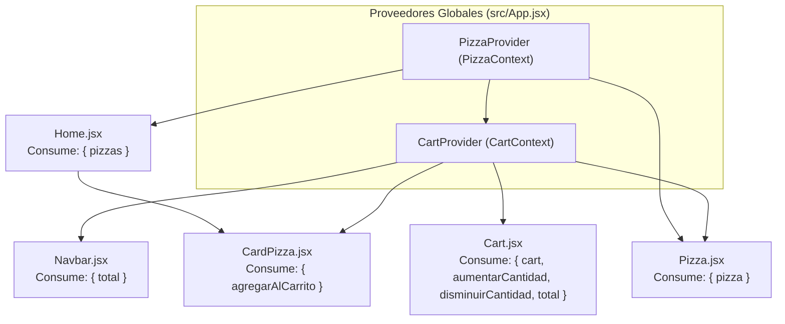

# 🍕 Pizzería Mamma Mía — Hito 6 (React Context API)


Aplicación web para **Pizzería Mamma Mía** desarrollada en **React + Vite**, correspondiente al **Hito 6 (Context API)** de **Desafío Latam**. En esta etapa se implementa el manejo de **estado global** utilizando **React Context API** para centralizar la lógica del carrito de compras y el consumo del catálogo de pizzas desde el backend.

---

## 🌐 Enlaces del Proyecto

- 🚀 **Demo en Producción (Vercel):** [https://hito-6-pizzeria-mamma-mia.vercel.app](https://hito-6-pizzeria-mamma-mia.vercel.app)
- 💻 **Repositorio en GitHub:** [https://github.com/jleival/hito-6-pizzeria-mamma-mia](https://github.com/jleival/hito-6-pizzeria-mamma-mia)
- 🔌 **API Backend (Render):** [https://pizzeria-backend-60le.onrender.com/api/pizzas](https://pizzeria-backend-60le.onrender.com/api/pizzas)

---

## 🎯 Objetivo del Hito 6

Implementar el manejo de estado global en la aplicación utilizando **Context API** (`createContext`, `Provider` y `useContext`), permitiendo que múltiples componentes (`Navbar`, `Home`, `CardPizza`, `Cart` y `Pizza`) compartan y actualicen en tiempo real la información del carrito de compras y el catálogo de productos sin recurrir a *prop drilling*.

---

## ✅ Requerimientos Cumplidos

| # | Requerimiento | Estado | Implementación |
| :---: | :--- | :---: | :--- |
| **1** | Implementar un Context para manejar el carrito de compras de la aplicación. | ✅ Cumplido | Creación de `CartContext` y `CartProvider` en `src/context/CartContext.jsx`, envolviendo la aplicación en `src/App.jsx`. |
| **2** | Consumir `CartContext` en el `Navbar` para mostrar el precio total de los productos. | ✅ Cumplido | Uso de `useContext(CartContext)` en `src/components/Navbar.jsx` para renderizar `total` dinámicamente. |
| **3** | Permitir al usuario agregar productos al carrito desde `Home` (botón *Añadir* de cada card). | ✅ Cumplido | Conexión de `agregarAlCarrito` en `src/components/CardPizza.jsx` y `src/pages/Pizza.jsx`. |
| **4** | Mostrar los productos agregados en la página `Cart` y permitir incrementar o eliminar unidades. | ✅ Cumplido | Consumo de `cart`, `aumentarCantidad` y `disminuirCantidad` en `src/pages/Cart.jsx`. |
| **5** | Calcular el total de la compra y sincronizarlo entre la página `Cart` y el `Navbar`. | ✅ Cumplido | Cálculo reactivo mediante `cart.reduce(...)` en `CartContext.jsx` compartido entre ambos componentes. |
| **6** | *(Opcional)* Llevar el consumo de las pizzas (`fetch` de `Home` y `Pizza`) a un Context. | ✅ Cumplido | Creación de `PizzaContext` y `PizzaProvider` en `src/context/PizzaContext.jsx`. |

---

## 🏗️ Arquitectura de Estado Global (Context API)



### Detalle de los Contextos Implementados

1. **`CartContext.jsx`:**
   - **`cart`**: Estado con el listado de pizzas en el carrito.
   - **`agregarAlCarrito(pizza)`**: Verifica si la pizza ya existe en el carrito (normalizando IDs con `.toLowerCase()`). Si existe, incrementa su cantidad (`count + 1`); si no existe, la incorpora con `count: 1`.
   - **`aumentarCantidad(id)`**: Incrementa en `1` la cantidad de una pizza existente.
   - **`disminuirCantidad(id)`**: Resta `1` a la cantidad y, si llega a `0`, elimina automáticamente el producto del carrito usando `.filter(item => item.count > 0)`.
   - **`total`**: Calcula el monto total acumulado en tiempo real usando `.reduce()`.

2. **`PizzaContext.jsx`:**
   - Centraliza las peticiones `fetch` hacia el backend desplegado en **Render** (`/api/pizzas` y `/api/pizzas/p001`).
   - Actúa como caché en memoria durante la navegación SPA, evitando peticiones HTTP redundantes al cambiar entre vistas.

---

## 📂 Estructura del Proyecto

```text
hito-6-pizzeria-mamma-mia/
├── docs/
│   └── 03_d_Hito_6_-_Pizzería_Mamma_Mía.pdf
├── public/
│   └── img/                  # Imágenes locales de respaldo (p001.jpeg - p006.jpeg)
├── src/
│   ├── assets/               # Recursos gráficos y capturas
│   ├── components/
│   │   ├── CardPizza.jsx     # Tarjeta de pizza conectada a CartContext
│   │   ├── Footer.jsx        # Pie de página
│   │   ├── Header.jsx        # Banner principal
│   │   └── Navbar.jsx        # Barra de navegación con total dinámico desde CartContext
│   ├── context/
│   │   ├── CartContext.jsx   # Estado global y operaciones del carrito de compras
│   │   └── PizzaContext.jsx  # Consumo centralizado de la API REST de pizzas
│   ├── data/
│   │   └── pizzas.js         # Datos iniciales simulados (pizzaCart)
│   ├── pages/
│   │   ├── Cart.jsx          # Vista del carrito conectada a CartContext
│   │   ├── Home.jsx          # Catálogo principal conectado a PizzaContext
│   │   ├── Login.jsx         # Formulario de inicio de sesión
│   │   ├── NotFound.jsx      # Página 404 personalizada
│   │   ├── Pizza.jsx         # Detalle de pizza individual (p001)
│   │   ├── Profile.jsx       # Perfil de usuario
│   │   └── Register.jsx      # Formulario de registro
│   ├── App.jsx               # Configuración de rutas y Providers (PizzaProvider + CartProvider)
│   └── main.jsx              # Punto de entrada con BrowserRouter
├── .env                      # Variable de entorno VITE_API_URL
├── package.json
└── vite.config.js
```

---

## ⚙️ Instalación y Ejecución Local

Sigue estos pasos para clonar y ejecutar el proyecto en tu máquina local:

1. **Clonar el repositorio:**
   ```bash
   git clone https://github.com/jleival/hito-6-pizzeria-mamma-mia.git
   cd hito-6-pizzeria-mamma-mia
   ```

2. **Instalar las dependencias:**
   ```bash
   npm install
   ```

3. **Configurar las variables de entorno:**
   Crea un archivo `.env` en la raíz del proyecto con la URL del backend:
   ```env
   VITE_API_URL=https://pizzeria-backend-60le.onrender.com
   ```

4. **Iniciar el servidor de desarrollo:**
   ```bash
   npm run dev
   ```
   Luego abre en tu navegador la dirección indicada en la terminal (por defecto `http://localhost:5173`).

---

## 🛠️ Tecnologías Utilizadas

- **React 19** (`createContext`, `useContext`, `useState`, `useEffect`)
- **React Router DOM v7** (`BrowserRouter`, `Routes`, `Route`, `Link`)
- **React Bootstrap & Bootstrap 5** (Diseño responsivo y componentes UI)
- **Vite 8** (Empaquetador y entorno de desarrollo rápido)
- **Vercel & Render** (Despliegue continuo de Frontend y Backend API)

---

## 👨‍💻 Autor

Desarrollado por **Jorge Leiva** ([@jleival](https://github.com/jleival))  
Bootcamp **Desarrollo Full Stack JavaScript** — *Academia Desafío Latam*.
